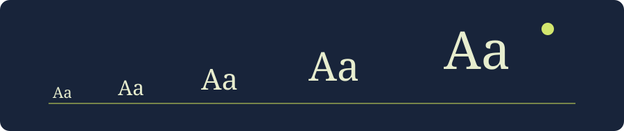

# Type Scale Studio

A typography workbench for building a deliberate type system instead of guessing font sizes one heading at a time.



## Features
- Generate a geometric scale from a base size and ratio.
- Preview a real specimen with heading, body and caption styles.
- Export named CSS custom properties.
- Works locally with no account, build step or network requests.

## Run
Open `index.html` in a modern browser. Node.js 18+ runs the tests:

```bash
node --test tests.mjs
```

## Design notes
An editorial specimen sheet: generous whitespace, ink-blue type and a citrus accent. Hero motion is decorative and respects reduced-motion preferences.

## Scope
Sizes are calculated in CSS pixels using a geometric progression. Font metrics differ by typeface; use the live specimen to judge optical rhythm.

## Contributing
Keep scale generation deterministic and add tests for invalid inputs and boundary values.

## License
MIT.
